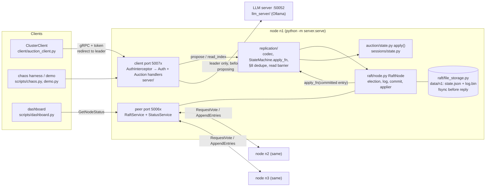

# Distributed Auction System

An online auction (log in, create an auction, bid, automatic close, one winner)
replicated across three servers with **Raft, implemented from the paper**
(Ongaro & Ousterhout, extended version; no Raft library). Python 3 and gRPC.
Every state change is a command in the Raft log, applied by one deterministic
`apply()` on every node, so all replicas hold the same auctions. A local LLM
writes item descriptions, and its text is replicated as plain data.
Built for CS G623 (Advanced Operating Systems). It ships with a seeded chaos
harness and a property checker that tests the guarantees on real processes.

---

## Architecture



- **Client port** (50071-50073): `AuthService` and `AuctionService` behind a
  session-token interceptor. A follower answers "not leader, try *there*".
- **Peer port** (50061-50063): `RaftService` (the two Raft RPCs) and
  `StatusService` (read-only status for the dashboard and checker). It has no
  auth (decisions.md A9, T2).
- **Write path:** handler → `propose()` → leader's log → majority → commit →
  `apply()` on every node → reply. Walkthrough:
  [docs/auction-on-raft.md](docs/auction-on-raft.md) §2.
- **Reads** are served only by the leader, after a read-index round
  (decisions.md A14, A15).

---

## Environment (PowerShell): setup

Bare `python` on this machine may resolve to a different install (miniforge),
so every command below uses the venv's interpreter explicitly.

```powershell
git clone https://github.com/MrudulDhaduk/Distributed-Auction-System
cd Distributed-Auction-System
python -m venv .venv
.venv\Scripts\python.exe -m pip install -r requirements.txt
```

`requirements.txt` pins `grpcio` and `grpcio-tools` to 1.83.0 and adds
`pytest`, `rich` (dashboard) and `ollama` (LLM server). It was developed on
Python 3.13.13.

**Optional: the LLM.** Install [Ollama](https://ollama.com/download), then:

```powershell
ollama pull qwen3:4b-instruct-2507-q4_K_M
```

Without Ollama the system still runs: description generation fails fast and
the auction is created with an empty description (decisions.md A10;
[docs/design-notes.md](docs/design-notes.md) explains the model choice).
**Every recorded chaos run and the recorded demo run were made without
Ollama running.** The LLM server was up, every description call failed fast,
and the description degraded to `""`. So the "call, then degrade" path is
exercised, but real generated text never was
([docs/testing-and-chaos.md](docs/testing-and-chaos.md) Known gaps 6;
`runs\demo-20261109-220454\logs\llm.log`). The stress writes make no LLM
call at all.

The generated gRPC stubs are committed in `generated\`. After changing a
`.proto` file, regenerate them:

```powershell
.venv\Scripts\python.exe scripts\gen_proto.py
```

---

## Running it

### One node

A cluster of one elects itself and commits on its own vote:

```powershell
.venv\Scripts\python.exe -m server.serve --node-id n1 --client-port 50071 --peer-port 50061 --data-dir data\solo
# in a second window:
.venv\Scripts\python.exe -m client.auction_client --nodes 127.0.0.1:50071
```

Checked by hand on 2026-11-10, without the LLM: the node logged
`term 1 CANDIDATE -> LEADER: won election with 1 votes`, then
`appended no-op at index 1`, and the client flow finished with
`winner: "mrudul"`. `--data-dir` is required (decisions.md A13).

### A 3-node cluster

```powershell
.\scripts\run_cluster.ps1            # LLM server + n1, n2, n3, one window each
.\scripts\run_cluster.ps1 -NoLLM     # same, without the LLM server
.\scripts\run_cluster.ps1 -DryRun    # print the command lines only
```

Each node keeps term, vote and log in `data\<id>`. To kill the leader, close
its window. To restart a node, run its line from `-DryRun`: it replays its log
from disk, and the leader sends it what it missed.

If `data\` was written before commit `cd8128a` (the time-conversion fix,
decisions.md T1), wipe it first: `Remove-Item -Recurse data`.

### The client

```powershell
.venv\Scripts\python.exe -m client.auction_client
```

It runs the scripted flow: four logins, one auction ("vintage clock", closes in
25 s), bids of 150 and 200 and an equal 200 that is refused, then it waits for
the close and prints the final auction. It follows leader redirects and
retries with the same `(client_id, seq)` (decisions.md A17, A18). Close the
leader's window mid-run to watch it fail over.

Seeded accounts: `mrudul`, `nisarg`, `karan`, `tanmay`, password `pass`
(`server/auth_servicer.py`).

### The dashboard

```powershell
.venv\Scripts\python.exe scripts\dashboard.py                    # a run_cluster.ps1 cluster
.venv\Scripts\python.exe scripts\dashboard.py --base-peer 50081  # a chaos or stress cluster
```

It shows, per node, the role, term, leader, commitIndex, lastApplied, last log
entry and state digest, plus one verdict: `agree`, `catching up` or
`DIVERGED` ([docs/testing-and-chaos.md](docs/testing-and-chaos.md) §2).

### The scripted demo

```powershell
.\scripts\demo.ps1 -Pause 4
```

It opens the dashboard and runs `scripts\demo.py`: start the LLM server and 3
nodes, log in, create an auction, race two equal bids, kill -9 the leader,
keep bidding, restart the dead node, wait for the close, then run the
checker. `demo.py` was run (`--pause 0.3`, all eight properties passed). The
`demo.ps1` wrapper itself was only syntax-checked, never run end to end.
Minute-by-minute script: [docs/demo-runsheet.md](docs/demo-runsheet.md).

Do not run the demo and `run_cluster.ps1` at the same time: they use the same
ports.

---

## Tests, stress, chaos, checker

```powershell
.venv\Scripts\python.exe -m pytest -q                                   # the whole suite (~75 s)
.venv\Scripts\python.exe -m pytest tests\test_raft_election.py -v       # one file
.venv\Scripts\python.exe scripts\stress.py all                          # throughput + 3 failover configs
.venv\Scripts\python.exe scripts\stress.py throughput --clients 1,2,4,8,16 --seconds 15
.venv\Scripts\python.exe scripts\stress.py failover --kills 20
.venv\Scripts\python.exe scripts\chaos.py --duration 600                # 10 minutes, prints its seed
.venv\Scripts\python.exe scripts\chaos.py --seed 634526 --duration 600  # same fault schedule again
.venv\Scripts\python.exe -m checker runs\chaos-634526-20261110-104604   # re-check a saved run
```

- The suite runs offline. It fakes the LLM, and most tests use an in-memory
  transport. A few start real gRPC servers or child processes on local ports
  (for example `test_workload.py`, `test_failover_grpc.py`,
  `test_serve_grpc.py`, `test_harness.py`). Don't run the suite during a chaos
  run (testing-and-chaos.md Known gaps 13).
- Last full run: 377 passed, 3 xfailed. The 3 are strict xfails: the
  persistence tests run against MemoryStorage, to prove those tests can fail
  (decisions.md P13).
- Chaos and stress use ports 50081-50083 (peer), 50091-50093 (client) and
  50059 (LLM). Output goes to `runs\` (gitignored, not in the submission zip).
- A seed fixes the fault **schedule**, not the run. Thread timing and who
  leads when a fault fires are not replayable (decisions.md T9).
- `chaos.py` exits 0 only if every property passed.

### The eight checker properties ([checker/properties.py](checker/properties.py))

| property | one line |
|---|---|
| `history-well-formed` | per client: no overlapping writes, seq strictly increasing; every bid `(auction, bidder, amount)` is unique |
| `acked-writes-on-every-node-exactly-once` | every acknowledged bid is on every node exactly once; every acknowledged create and login is there too |
| `replicas-identical` | all nodes at the same `digest_index`, with the same digest and the same full state JSON |
| `bids-strictly-increasing-winner-is-max` | within an auction each bid beats the previous one; a closed auction's winner is its highest bid |
| `no-bid-accepted-after-close` | every bid stamp ≤ close time, and no bid the client *started* after the close was accepted |
| `rejections-consistent-with-final-state` | a refused bid is absent, and its stated reason ("highest bid is H", "closed", "time is up") matches the final state |
| `unknown-outcome-at-most-once` | a bid whose outcome the client never learned is present 0 or 1 times, never twice |
| `at-most-one-leader-per-term` | Figure 3 Election Safety, over every leader seen in status polls and node logs |

Each property has a test that breaks exactly it (`tests/test_checker.py`).
What the checker does **not** prove: [docs/viva-prep.md](docs/viva-prep.md)
Q15.

---

## Results

All runs on one machine: AMD Ryzen 7 8840HS (8 cores / 16 threads), 19.8 GB
RAM, NVMe SSD, Windows 11, Python 3.13.13. Three nodes on 127.0.0.1 with fsync
on every write. Every number below is copied from the source in the last
column. The `runs\` directories are local only (gitignored and not in the zip),
and their numbers are reproduced in the `docs\` files.

| what | result | source |
|---|---|---|
| Write throughput, 1 client | 210.5 accepted writes/s, p50 4.6 ms, p99 7.8 ms, 0 failed | [docs/stress-results.md](docs/stress-results.md); `runs\stress.out` |
| Write throughput, 16 clients | 688.1 accepted writes/s, p50 22.8 ms, p99 31.7 ms, 0 failed | same |
| Failover, default timeouts 0.5-1.0 s (20 kills) | new leader (`t_elect`) p50 892.7 ms, max 1 118 ms; client's first write on the new leader (`t_write`) p50 2 209 ms; term +1 per kill (1 → 22) | `runs\failover.out`, `runs\stress-20261109-232357\results.json`; [docs/stress-results.md](docs/stress-results.md) |
| Failover, 0.15-0.3 s (17 kills) | `t_elect` p50 462 ms, max 875 ms; `t_write` p50 2 220 ms; terms 2 → 68 (spurious elections) | same |
| Failover, 0.15-0.15 s, no randomness (10 kills) | `t_elect` p50 11.6 s; 5 of 10 kills had no leader within 30 s; 1 866 terms | `runs\stress-20261109-234519\results.json`; [docs/stress-results.md](docs/stress-results.md) |
| Chaos run, seed 634526, 600 s | 58 faults; 11 256 writes (8 957 accepted bids, 2 137 rejected, 88 unknown, of which 3 committed once each); 63 auctions, all closed; all three nodes at `digest_index` 11 293; **all 8 properties PASS**, exit 0 | `runs\chaos-final2.out`, `runs\chaos-634526-20261110-104604\`; [docs/testing-and-chaos.md](docs/testing-and-chaos.md) §6 |
| Bid latency under that chaos run | p50 8.1 ms, p95 145 ms, max 5.65 s (unknowns excluded) | [docs/testing-and-chaos.md](docs/testing-and-chaos.md) §6; recomputed from `history.jsonl` |
| Earlier chaos run, seed 737075, 600 s | 58 faults; 8 247 writes; all 8 properties PASS (made before the T16 fix, so latencies are inflated) | [docs/testing-and-chaos.md](docs/testing-and-chaos.md) §6 |
| Aborted chaos run, seed 79402 | no verdict: the harness killed itself at 562 s (PID reuse, decisions.md T19). Not a system failure, and no checker ran | same |

Why the client waits ~2.2 s when Raft needs ~0.9 s: Windows takes 2.0 s to
refuse a TCP connect to a dead localhost port, and the client's first retry
goes to the dead leader (decisions.md T18).

---

## Design decisions that matter

Each item names its entry in [docs/decisions.md](docs/decisions.md) (Raft
paper section in brackets).

- **Election timeout 0.5-1.0 s, heartbeat 0.1 s, not the paper's 150-300 ms.**
  At 0.15-0.3 s, Python stalls on Windows caused spurious elections (E1;
  measured in stress-results.md). [§5.2, §5.6]
- **Only one place changes the term,** and it clears the vote with it (E10).
  [Figure 2, Figure 3]
- **The lock is never held during an outgoing RPC,** and every reply re-checks
  term and role (E3, E4).
- **The commit rule counts replicas only for current-term entries** (R8).
  [§5.4.2, Figure 8]
- **A new leader appends a no-op** so that earlier entries commit without
  waiting for a client (R9). [§8]
- **Log repair is the plain `nextIndex -= 1`,** with no conflict-term
  shortcut (R6). The follower truncates only on a real conflict (R10). [§5.3]
- **Durable before reply:** term, vote and every log append are fsync'd
  inside the storage call, under the node lock, before the reply is built
  (R5, P8). The leader counts itself only after its own fsync (P9).
  [Figure 2]
- **A torn last record is cut off. Damage anywhere else stops the node** (P6,
  P7).
- **Restart replays the whole log. There are no snapshots** (P11). [§7 not
  implemented]
- **Commands are a protobuf `oneof` with times as epoch microseconds** (A1).
  Time conversion is exact integer arithmetic (T1).
- **Non-determinism stays outside `apply()`.** The leader stamps `curr_time`
  before proposing (A10), mints session tokens before proposing (A3), and
  calls the LLM before proposing (A10).
- **§8 dedupe in `apply_fn`:** one `(seq, response)` per `client_id`, so a
  retry after an unknown outcome executes at most once (A5).
- **Sessions are replicated** as Login/Logout commands, so a token survives
  failover (A3, A16).
- **The closer runs on every node but proposes only on the leader** (A7).
- **Reads go to the leader only, behind read-index.** That is a heartbeat
  round, not a log write (A14, A15). [§8]
- **Faults are real:** `TerminateProcess` and `NtSuspendProcess` on the whole
  process tree (T6, T19).
- **The checker is a set of pure functions** over history and final dumps,
  each with a test that breaks it (T10).

---

## Known limitations

Copied from the Known-gaps sections of the walkthroughs. The full lists are
there.

- **Crash faults only.** Every injected fault is a process kill or suspend on
  one machine. There are no network partitions between real processes, no
  clock skew, no disk faults, and no Byzantine behaviour. Clients and servers
  share one clock, which one checker rule relies on
  ([testing-and-chaos.md](docs/testing-and-chaos.md) gaps 4 and 2). On
  Windows, power loss right after a rename could roll back a vote
  ([raft-persistence.md](docs/raft-persistence.md) gap 1, decisions.md P3).
  That was not tested.
- **`apply()` costs O(bids) per bid.** M1's `max(...)` scans the auction's bid
  list. Measured: 0.15 ms at 1 000 bids, 2.85 ms at 25 000. The stress writer
  starts a new auction every 1 000 bids for this reason
  ([testing-and-chaos.md](docs/testing-and-chaos.md) gap 10).
- **Catch-up costs one RPC per missing entry.** Plain Figure 2 backoff
  (decisions.md R6), so a follower N entries behind is probed N times
  ([testing-and-chaos.md](docs/testing-and-chaos.md) gap 11).
- **The whole log is replayed on restart.** With no snapshots, recovery time
  grows with history. Restarted nodes' logs reached 39 507 entries in the
  failover stress run. That this caused the late "not settled" waits is
  inferred, not measured ([testing-and-chaos.md](docs/testing-and-chaos.md)
  gap 14, [stress-results.md](docs/stress-results.md)).
- **Client failover is floored at ~2 s on Windows** by the 2.0 s connect
  refusal to the dead leader's port (decisions.md T18,
  [testing-and-chaos.md](docs/testing-and-chaos.md) gap 12).
- **A resumed follower deposes a healthy leader.** There is no PreVote and no
  §6 rule (decisions.md T15). This costs liveness, never safety.
- **Reads were never exercised by the chaos workload.** The workload only
  writes. Read-index is covered by unit tests (`test_raft_read_index.py`,
  `test_reads_on_raft.py`) and by the demo's two `GetAuction` calls.
- **The peer port is plain TCP with no auth.** Session tokens are stored in
  plain text in `log.bin` ([auction-on-raft.md](docs/auction-on-raft.md) §15).
- **Not built from the problem statement:** the mock payment/escrow service
  and an `ExtendAuction` command. The LLM server's FAQ
  (`AnswerBiddingQuestion`) and result-summary (`SummariseAuctionResult`)
  RPCs exist and can be called directly (`scripts\llm_rpc_smoke.py`), but the
  auction server never calls them. The dashboard shows a state digest rather
  than each node's high bid.

---

## Where to read next

| file | what |
|---|---|
| [docs/raft-election.md](docs/raft-election.md) | election, rule by rule against Figure 2, with a trace |
| [docs/raft-replication.md](docs/raft-replication.md) | log replication, repair, Figure 8, the no-op |
| [docs/raft-persistence.md](docs/raft-persistence.md) | FileStorage, durable-before-reply, torn tails |
| [docs/auction-on-raft.md](docs/auction-on-raft.md) | the auction on the log, sessions, dedupe, read-index, the client |
| [docs/testing-and-chaos.md](docs/testing-and-chaos.md) | status RPC, dashboard, chaos harness, checker, results |
| [docs/stress-results.md](docs/stress-results.md) | throughput, latency, failover vs. the paper's Figure 16 |
| [docs/decisions.md](docs/decisions.md) | every non-obvious choice, with the viva question |
| [docs/viva-prep.md](docs/viva-prep.md) | likely questions, short answers, reading order |
| [docs/design-notes.md](docs/design-notes.md) | M1 notes: the close loop, the LLM model choice |

---

## Submission zip

```powershell
.\scripts\make_submission.ps1                  # -> dist\Distributed-Auction-System-<time>.zip
.\scripts\make_submission.ps1 -OutDir C:\tmp
```

It prints the zip path and every file in it. It contains the code, `generated\`,
`proto\`, `scripts\`, `tests\`, `docs\`, README, LICENSE, `requirements.txt` and
`pytest.ini`. It leaves out `.venv`, `data\`, `__pycache__`, `.git`,
`papers\`, CLAUDE.md, CLAUDE.old.md, `runs\`, `logs\`, `dist\`, and the
personal note folders `MyNotes\`, `Learning\` and `Documents\`. Tested by
`tests\test_make_submission.py`.
