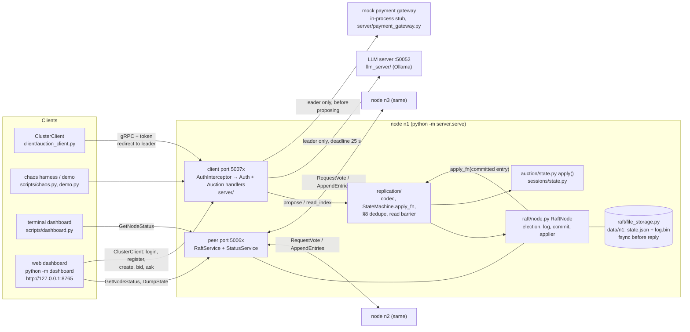

# Distributed Auction System

An online auction (log in, create an auction, bid, automatic close, one winner)
replicated across three servers with **Raft, implemented from the paper**
(Ongaro & Ousterhout, extended version; no Raft library). Python 3 and gRPC.
Every state change is a command in the Raft log, applied by one deterministic
`apply()` on every node, so all replicas hold the same auctions. After an
auction closes, its winner pays into a mock **escrow** and the seller releases
or refunds it. A local **LLM on a separate server** answers bidding questions,
writes item descriptions and result summaries, and summarises price trends;
its text is replicated as plain data, never as a call.
Built for CS G623 (Advanced Operating Systems). It ships with a seeded chaos
harness and a property checker that tests the guarantees on real processes.
Requirement-by-requirement status: [docs/requirements-audit.md](docs/requirements-audit.md).

**Want to see it working?** Run `docker compose up --build` (see
[Run it with Docker](#run-it-with-docker-groundhog)) or
`.venv\Scripts\python.exe -m dashboard --open`, and follow
[Walk through the demo yourself](#walk-through-the-demo-yourself-web-dashboard): a
browser dashboard that starts the cluster, shows every replica and its heartbeats live,
and lets you kill nodes, create users and auctions, bid, and ask each auction's assistant.

**Who wrote what.** The M1 code (`auction/state.py`'s `apply()` and commands,
gRPC, auth and sessions, the closer, the LLM server) was written by the author.
Two M1 commits are by Nisarg Vagh (`8374041`, `172b0bc`). The M2 code (Raft,
persistence, replication, the harness and checker, and this chunk's payment and
LLM wiring) was built with Claude Code, one chunk at a time, under the author's
review: each chunk was studied, discussed and committed by the author.

---

## Architecture



- **Client port** (50071-50073): `AuthService`, `AuctionService`,
  `PaymentService` and `AssistantService` behind a session-token interceptor.
  A follower answers "not leader, try *there*".
- **Peer port** (50061-50063): `RaftService` (the two Raft RPCs) and
  `StatusService` (read-only status for the dashboard and checker). It has no
  auth (decisions.md A9, T2).
- **Write path:** handler → `propose()` → leader's log → majority → commit →
  `apply()` on every node → reply. Walkthrough:
  [docs/auction-on-raft.md](docs/auction-on-raft.md) §2.
- **Reads** are served only by the leader, after a read-index round
  (decisions.md A14, A15).

---

## Run it with Docker (GroundHog)

The quickest way to run everything, on any machine with Docker Desktop: no
Python, venv or Ollama install needed.

```powershell
docker compose up --build        # first time: builds the image, downloads the model (~2.5 GB, once)
```

Open **http://localhost:8765** and follow
[Walk through the demo yourself](#walk-through-the-demo-yourself-web-dashboard).
`docker compose down` stops everything; the model stays cached for next time.

| container | what runs in it |
|---|---|
| `ollama` | the model server, `ollama/ollama:0.34.4` (CPU); models in the volume `groundhog-ollama-models` |
| `model` | one-shot: pulls `qwen3:4b-instruct-2507-q4_K_M` into that volume, then exits |
| `auction` | image `groundhog:local` (Python 3.11): the web dashboard, the LLM server and the Raft nodes n1, n2, n3 as separate processes |

The nodes are processes inside one container, not one container each, on
purpose: the dashboard starts them itself, so **Kill -9, Suspend, Resume and
Restart work exactly as without Docker** (on Linux they are SIGKILL, SIGSTOP
and SIGCONT). Node logs, scenario results and replays are written to `runs\`
on your machine (a bind mount).

Variations:

```powershell
$env:DASHBOARD_PORT=8770; docker compose up --build                 # 8765 is taken
$env:DASHBOARD_LLM="fake"; docker compose up --build auction --no-deps   # canned answers, no model download
docker compose run --rm auction python -m pytest -q                 # the test suite, on Linux
```

Measured on 2026-11-18 (Docker Desktop 29.9.2 on the dev laptop):

- The full dashboard check (three leader kills, a cut link, an isolated
  leader, Classic vs PreVote, a Vintage clock scenario with a kill and a
  partition) passed in the container, 10/10 checker properties, never two
  leaders in one term.
- Failover is faster on Linux: a new leader about **0.63 s** after a kill
  (1.2-1.6 s on Windows) and the first bid after it in 0.1-0.2 s, because
  Linux refuses a connection to a dead port at once instead of after 2 s.
- The real model works through the containers but is slower: about 6-7 s per
  answer, against 1-2 s with Ollama on Windows, since Docker Desktop gives the
  model only part of the CPU.
- The test suite in the container: 780 passed, 11 skipped (Windows-only
  process tests), 3 xfailed.
- `docker stop` stops the dashboard and the nodes it started cleanly (exit 0,
  about 1 s).

---

## Environment (PowerShell): setup

Bare `python` on this machine may resolve to a different install (miniforge),
so every command below uses the venv's interpreter explicitly.

```powershell
git clone https://github.com/MrudulDhaduk/Distributed-Auction-System
cd Distributed-Auction-System
python -m venv .venv
.venv\Scripts\python.exe -m pip install -r requirements.txt
```

`requirements.txt` pins `grpcio` and `grpcio-tools` to 1.83.0 and adds
`pytest`, `rich` (dashboard) and `ollama` (LLM server). It was developed on
Python 3.13.13.

**The LLM.** Install [Ollama](https://ollama.com/download), then pull the
model (about 2.5 GB, runs on the CPU) and start the LLM server, which is its
own process on port 50052:

```powershell
ollama pull qwen3:4b-instruct-2507-q4_K_M
.venv\Scripts\python.exe -m llm_server.serve                 # the LLM server (model name is in llm_server\config.py)
.venv\Scripts\python.exe scripts\llm_rpc_smoke.py            # one call per job, to check it works on its own
```

`run_cluster.ps1` and `demo.ps1` start the LLM server for you. The first call
after Ollama loads the model took 15.75 s on the dev machine; later calls took
1 to 7 s. Every call the nodes make carries a 25 s deadline.

Without Ollama the system still runs. A description at creation degrades to
`""`, and the assistant calls return a clear "the assistant is unavailable ...;
the auction is unaffected" answer (decisions.md C12, C13;
[docs/design-notes.md](docs/design-notes.md) explains the model choice).
**The recorded demo run used the real model** (see "The scripted demo"). **The
recorded chaos run used a canned-answer LLM server** (`--fake-llm`), not the
model: a 4B model on the CPU would share cores with Raft's election timers
(decisions.md C22).

The generated gRPC stubs are committed in `generated\`. After changing a
`.proto` file, regenerate them:

```powershell
.venv\Scripts\python.exe scripts\gen_proto.py
```

---

## Running it

### One node

A cluster of one elects itself and commits on its own vote:

```powershell
.venv\Scripts\python.exe -m server.serve --node-id n1 --client-port 50071 --peer-port 50061 --data-dir data\solo
# in a second window:
.venv\Scripts\python.exe -m client.auction_client --nodes 127.0.0.1:50071
```

Checked by hand on 2026-11-10, without the LLM: the node logged
`term 1 CANDIDATE -> LEADER: won election with 1 votes`, then
`appended no-op at index 1`, and the client flow finished with
`winner: "mrudul"`. `--data-dir` is required (decisions.md A13).

### A 3-node cluster

```powershell
.\scripts\run_cluster.ps1            # LLM server + n1, n2, n3, one window each
.\scripts\run_cluster.ps1 -NoLLM     # same, without the LLM server
.\scripts\run_cluster.ps1 -DryRun    # print the command lines only
```

Each node keeps term, vote and log in `data\<id>`. To kill the leader, close
its window. To restart a node, run its line from `-DryRun`: it replays its log
from disk, and the leader sends it what it missed.

If `data\` was written before commit `cd8128a` (the time-conversion fix,
decisions.md T1), wipe it first: `Remove-Item -Recurse data`.

### The client

```powershell
.venv\Scripts\python.exe -m client.auction_client
```

It runs the scripted flow: four logins, one auction ("vintage clock", closes in
25 s), bids of 150 and 200 and an equal 200 that is refused, then it waits for
the close and prints the final auction. It follows leader redirects and
retries with the same `(client_id, seq)` (decisions.md A17, A18). Close the
leader's window mid-run to watch it fail over.

Seeded accounts: `mrudul`, `nisarg`, `karan`, `tanmay`, password `pass`
(`sessions/users.py`). More accounts can be created at run time with
`AuthService.Register` (the web dashboard's "Create account" tab, or
`ClusterClient.register(username, password)`); see [Validation rules](#validation-rules).

### The terminal dashboard

For the browser dashboard see
[Walk through the demo yourself](#walk-through-the-demo-yourself-web-dashboard).
The terminal one only watches a cluster that something else started:

```powershell
.venv\Scripts\python.exe scripts\dashboard.py                    # a run_cluster.ps1 cluster
.venv\Scripts\python.exe scripts\dashboard.py --base-peer 50081  # a chaos or stress cluster
```

It shows, per node, the role, term, leader, commitIndex, lastApplied, last log
entry and state digest, plus one verdict: `agree`, `catching up` or
`DIVERGED` ([docs/testing-and-chaos.md](docs/testing-and-chaos.md) §2).

### Using it from Python

`ClusterClient` has the handout's functions: `login`, `logout`,
`post(token, type, data)`, `get(token, type, params)` and
`process_business_request(request_id, payload, context)`. `post` and `get` use the
typed RPCs; `process_business_request` calls the server's
`BusinessService.ProcessBusinessRequest`, which dispatches to the same handlers:

```python
c = ClusterClient(["127.0.0.1:50071", "127.0.0.1:50072", "127.0.0.1:50073"])
c.register("alice", "alice123")          # optional: a new, replicated account
c.login("mrudul", "pass")
c.post(c.token, "bid", {"auction_id": 1, "amount": 150})
c.post(c.token, "payment", {"auction_id": 1, "action": "pay", "amount": 150})   # the winner, after the close
c.get(c.token, "escrow", {"auction_id": 1})
c.get(c.token, "assistant", {"question": "Can I bid one more?", "auction_id": 1})
c.get(c.token, "price_trends", {})
```
`post` types: `auction`, `bid`, `payment` (`action`: `pay`, `release`, `refund`),
`description`. `get` types: `auction`, `auctions`, `escrow`, `assistant`,
`price_trends`. The seller releases or refunds; only the winner pays.

### The scripted demo

```powershell
.\scripts\demo.ps1 -Pause 4
```

It opens the dashboard and runs `scripts\demo.py`: start the LLM server and 3
nodes, warm the model, log in, create four auctions (the LLM writes each
description), start six background bidders (`bg1`-`bg6`, one client each) that
bid on auctions 2-4 until they close, race two equal bids on auction 1 (the
hero), ask the assistant about the live auction, kill -9 the leader **while the
background bidders are bidding**, keep bidding, restart the dead node, wait for
the closes (the hero closes last), show the LLM-written result summaries, have
the winners pay into escrow (the background winners with their own clients),
kill -9 the leader **again** and read the same escrow from the new leader,
release and refund the escrow, show price trends and the stall each leader kill
caused for the background bidders, then run the checker.

Run end to end on 2026-11-10 with the real model (`demo.ps1 -Pause 0.5`, exit
0, all ten properties PASS, 90.2 s with 0.5 s pauses). Timings printed by that
run: model warm-up 6.13 s, create auction including the LLM description 1.83 s,
assistant answer 1.14 s, close to summary visible 5.56 s, price trends 2.28 s.
At `-Pause 4` the same run is longer by about 3.5 s per step. Minute-by-minute
script: [docs/demo-runsheet.md](docs/demo-runsheet.md).

Run on 2026-11-10 at `-Pause 4` (the presenting speed), the four-auction demo:
all ten properties PASS, whole run 147.19 s. The background bidders made 599
bids (531 accepted, 68 refused, 0 errors); the first leader kill stalled a
background bid for 2.18 s. Its output and its replay are in
`runs\demo-20261110-150720` (local only).

Do not run the demo and `run_cluster.ps1` at the same time: they use the same
ports.

### Replay a demo run

Every demo run writes `runs\demo-<time>\events.jsonl`: one line per step,
client write, kill, restart, election, close, summary, escrow change and
checker result, each stamped with its time. The replay turns that file into one
self-contained HTML page (data, CSS and JavaScript inside it; no server, no
internet):

```powershell
.venv\Scripts\python.exe scripts\replay.py runs\demo-<time>
```

Open `runs\demo-<time>\replay.html` in a browser. Space plays and pauses, the
left and right arrows jump to the previous or next step, kill, election or
escrow change, the speed buttons set 0.5x to 5x, and the timeline jumps to any
marker. Dragging the slider rebuilds the state at that time from the events.
The page opens with a banner saying it is a replay, so it cannot be mistaken
for a live system. The end of the run shows the checker's result.

The replay is built by `scripts\replay.py`, and the state is computed there and
tested in `tests\test_replay.py`. The page only displays it.

---

## Walk through the demo yourself (web dashboard)

One command starts the LLM server, three Raft nodes and a web page that shows
them live and lets you act on them. Everything on the page comes from the
cluster: node rows from `StatusService.GetNodeStatus` (10 polls a second),
auctions and accounts from the leader's `DumpState` (3 a second), and every
action goes through the normal `ClusterClient`, so it follows leader
redirects and retries exactly as any client does.

### Start it

```powershell
.venv\Scripts\python.exe -m dashboard --open              # real LLM (needs Ollama + the model, see Environment)
.venv\Scripts\python.exe -m dashboard --open --llm fake   # canned LLM answers, no Ollama needed
.venv\Scripts\python.exe -m dashboard --llm none          # no LLM server: no descriptions, the assistant says it is unavailable
```

It prints the URL (`http://127.0.0.1:8765/`) and the run directory
(`runs\dashboard-<time>\`, with each node's `data\` and `logs\`). `--open`
opens the page in your browser and `--port` changes the HTTP port (8765, not
8080, because Docker and WSL listen on 8080 on the dev machine; the dashboard
binds its port exclusively and stops with an error if it is taken). **Ctrl+C
stops the dashboard and the cluster it started.** It uses the
`run_cluster.ps1` ports (client 50071-50073, peer 50061-50063, LLM 50052), so
do not run it at the same time as `run_cluster.ps1` or `demo.ps1`; on the
other hand `python -m client.auction_client` works against it unchanged. To
restart on the same logs (every node replays its log from disk):
`python -m dashboard --run-dir runs\dashboard-<time>`.

Wait until the header shows a gold **★ leader** pill and **LLM ready**. If it
says **LLM down**, Ollama is not running: start the Ollama app and restart the
dashboard, or use `--llm fake`. The first model load takes about 15 s, and the
dashboard does it in the
background.

### What is on the page

- **Cluster** (top left). Three nodes in a triangle; the leader is drawn in
  gold. **Gold dots** run from the leader to each follower: each one is an
  `AppendEntries` the follower accepted (its `heartbeats_received` counter
  went up between two polls). **Green dots** run back when the leader's reply
  counter for that follower goes up. The **ring** around a follower is its
  **election timer**: every heartbeat refills it, and if it runs out the node
  becomes a candidate (orange). A killed node is grey with a red cross, a
  suspended one is light blue. The box in the corner shows how many nodes are
  up and the majority needed (2 of 3).
- **Node cards** (under the triangle). Role, term, vote, leader, commit index,
  last applied, last log index and term, state digest (same colour means same
  state), pid and start count. Below that: heartbeats received (or sent, on
  the leader) with how long ago the last one arrived (the dot is green while
  they keep coming), the election-timer bar with the milliseconds left, and,
  on the leader, each follower's `matchIndex`/`nextIndex` and how long ago it
  last replied. Buttons: **Kill -9** (TerminateProcess on the whole process
  tree, no cleanup), **Suspend** / **Resume** (NtSuspendProcess: frozen,
  sockets stay open), **Restart** (same data dir: the node replays its log
  and the leader sends it what it missed).
- **Account** (right). Log in (one-click buttons for the test users, password
  `pass`) or **Create account**. Each browser **tab** is its own session, so
  two tabs can be two different users side by side.
- **Network bar** (under the triangle): click a line to cut or restore that
  link, or use **Isolate leader**, **Isolate a follower**, **Heal network**.
  See [Partitions](#partitions-cut-the-links-between-nodes) below.
- **Raft mode** (switch in the Cluster header): **Classic Raft** or
  **PreVote**. See [PreVote](#prevote-classic-raft-vs-the-improvement) below.
- **New auction**. Item, duration (30 s to 1 h, or custom 15 s to 30 days),
  optional attributes, and **Anti-sniping**. With attributes, the leader asks
  the LLM to write the description before it proposes the auction.
- **Auctions**. One card per auction: seller (marked `YOU` on your own),
  description, high bid, countdown and bar, the latest bids, the bid form,
  and after the close the winner, the summary and the escrow state. After the
  close the winner gets **Pay ... into escrow**, and once it is paid the
  seller gets **Release to me** and **Refund the winner**. An anti-sniping
  auction shows `anti-sniping`, or `extended ×N` once late bids have moved
  its close. **Ask assistant** opens that auction's own assistant (see step
  6); the seller also gets **Edit description**. Filters: All / Open / Closed
  / Mine.
- **Users** and **Events**. Every account, and a log of kills, elections,
  new leaders, users, auctions, bids, closes, summaries and escrow changes.
- **Scenarios** (under the cluster). Three buttons that start a predefined run
  on this same cluster, so you can kill, suspend and restart nodes while
  real clients are bidding (see below).

### Scenarios: run the predefined auctions and break things while they run

Each button starts real clients (one `ClusterClient` per user, with retries
and leader redirects) against the cluster the dashboard owns. Only one
scenario runs at a time. While it runs, use the node buttons as much as you
like: kill the leader, suspend a follower, kill two nodes, restart them.

| button | what it does | about |
|---|---|---|
| **Vintage clock** | nisarg sells a vintage clock (LLM description); karan, mrudul and tanmay bid, two of them bid 200 **at the same moment** (exactly one wins); the seller tries to bid on his own auction and is refused; karan asks the assistant; more bids every 5 s; after the close the winner pays into escrow and the seller releases it | 75 s |
| **Four auctions** | the scripted demo's setup: a hero vintage clock plus a film camera, a pocket watch and a record player; six background bidders `bg1`-`bg6` bid on the three until they close and pay for what they win; the hero gets bids and an equal-bid race; at the end the seller releases three escrows and refunds one | 2 min |
| **Chaos workload** | the chaos harness's workload (`harness/workload.py`): sellers creating auctions, bidders, three racers sending equal bids at once, payers; choose 1, 2 or 5 minutes. Tick **automatic faults** to also run the chaos harness's random fault schedule (leader and follower kills and suspends, each healed after a few seconds) on top of yours | 1-5 min |

The card shows the steps as they happen (newest first), the write counts
(accepted, refused, unknown outcome) and a **Stop** button. When the run ends
or you stop it, the dashboard:

1. restarts any node that is dead and resumes any that is suspended;
2. waits until all three replicas agree;
3. collects every node's `DumpState` and runs **the same ten checker
   properties as the chaos run** on everything the scenario's clients saw;
4. shows PASS / FAIL for each property on the card, with the first piece of
   evidence for a failure, and saves the run (history, dumps, report) in
   `runs\dashboard-<time>\scenario-<n>-<name>\`. Re-check it any time with
   `.venv\Scripts\python.exe -m checker runs\dashboard-<time>\scenario-<n>-<name>`;
5. builds a **replay** of the run and shows an **Open replay** link. The
   replay is the same page `scripts\replay.py` makes for the scripted demo:
   a timeline with every step, your kills and restarts, elections, bids,
   closes, escrow changes and the checker result, playable at 0.5x to 5x. It
   is saved as `replay.html` in the run's folder, next to `events.jsonl`.

Measured on 2026-11-17: **Vintage clock** with a leader kill and restart
mid-run, 18 writes, all 10 properties PASS. **Four auctions** with a leader
kill, a follower suspend/resume and a restart mid-run, 897 writes, all 10 PASS.
**Chaos workload**, 60 s with automatic faults (3 leader kills, 3 suspends),
771 writes, all 10 PASS (after the checker learned the create refusal below).

The first chaos run found a checker gap: a seller's create, retried across a
leader kill for longer than the auction's lifetime, reached the new leader
after its own close time and was correctly refused ("The close time must be
in the future"), but the checker did not know that reason. It now accepts it
only if the close time really had passed when the reply came.

The checker reads the whole replicated state, so anything you did by hand in
the same cluster is checked as well.

### PreVote: classic Raft vs the improvement

The switch in the Cluster header changes how every node starts an election.
It takes effect at once and is re-applied to a node that is restarted.

- **Classic Raft** (the paper's Figure 2, the default). When a follower's
  election timer runs out, it raises its term and asks for votes. A node that
  was frozen or cut off has its timer run out while it cannot hear the
  leader, so when it comes back it raises the term, and the leader steps down
  on seeing the higher term. Nothing is lost, but there is an election for no
  reason.
- **PreVote** (Ongaro's thesis, section 9.6). When the timer runs out, the
  node first asks "would you vote for me in term T+1?" without changing its
  own term. The others say yes only if that term is ahead of theirs, its log
  is at least as up to date as theirs, and they have not heard from a leader
  within the minimum election timeout. Only a majority of yes starts the real
  election. A node coming back from a freeze gets no, and simply goes back
  to following the leader. If the leader really is dead, nobody hears from
  it, so the pre-vote succeeds and a new leader is elected as before.

Measured on the dashboard (2026-11-18), suspending a follower for 3 s and
resuming it, twice in each mode: Classic, the resumed node became leader
both times and the term went up by one (n3→n1, term 1→2; n1→n2, term 2→3).
PreVote, the same leader and the same term both times (n1 in term 2; n2 in
term 3). Tests: `tests/test_raft_prevote.py`.

How it is built: `RequestVote` has a `preVote` flag (`proto/raft.proto`); a
node answering a pre-vote changes no state (`raft/node.py`
`_answer_prevote`); `StatusService.SetPreVote` switches a node at run time;
`python -m server.serve --prevote` starts a node with it on.

### Anti-sniping

Tick **Anti-sniping** when creating an auction. A bid that arrives in the
last 10 s moves the close to 10 s after that bid, at most 5 times per
auction. It is decided inside `apply()` from the bid's own timestamp (stamped
by the leader), so every replica extends the same auction to the same time;
the closer reads the current close time, so it waits for the new one. The
bid's answer says so (`Bid of 150 added; late bid, closing time extended
(1/5)`). Measured: a bid 3 s before the close moved it by 7 s. Tests:
`tests/test_validation_rules.py`.

### Payments from the page

After an auction closes, the winner sees **Pay <amount> into escrow** on its
card, and after that the seller sees **Release to me** and **Refund the
winner**. The page only shows each button to the person allowed to press it,
and `apply()` refuses anyone else whatever client they use. Checked on
2026-11-18: a non-winner paying, a second payment, the seller releasing
before payment, and a non-seller releasing were each refused, and pay, then
release, ended in RELEASED; pay, then refund, ended in REFUNDED.

### Partitions: cut the links between nodes

Under the triangle there is a network bar. **Click any line between two
nodes** to cut that link; click it again to restore it. A cut link turns red
and shows `cut`. With three links you can make any shape: one node alone,
the leader alone, or a single cut link with everyone still connected through
the third node. The bar also has **Isolate leader**, **Isolate a follower**
and **Heal network**. A scenario heals the network before its checker runs.

What a cut does: each node keeps a list of peers it is cut off from, and Raft
messages to or from them are dropped in both directions, as if the cable were
unplugged (`raft/node.py` `set_blocked_peers`, switched over
`StatusService.SetBlockedPeers`). The client ports are not cut, so clients
can still reach every node, which is what makes the cut-off leader visible.

Try **Isolate leader**, then bid:

1. The two connected nodes stop hearing the leader, elect a new one in a
   higher term, and carry on.
2. The cut-off node still says it is the leader: the page shows it as
   **old leader** (dashed) with `LEADER (old term)` on its card, and its
   commit index stops moving. Two leaders at once, in different terms; only
   the one with a majority can commit.
3. A bid sent to the old leader is accepted into its log but cannot commit.
   The client gets "outcome unknown" after the commit timeout and retries on
   another node with the same serial number, where it commits.
4. **Heal network**: the old leader sees the higher term, steps down, and its
   uncommitted entry is replaced by the new leader's log. The bid is in the
   state exactly once.

Measured on 2026-11-18: n3 (leader, term 1) isolated; n2 became leader in
term 3 while n3 still reported LEADER in term 1 with its commit index stuck;
a bid sent during the partition answered after 5.2 s (first the old leader,
then the retry on n2); after healing n3 was a follower in term 3, all three
at the same commit index, and the bid was in the state once. Cutting only
n1-n2 kept writes working (both still reach n3), at the cost of a few
elections in Classic mode. With **PreVote** on, an isolated follower does not
raise its term while cut off (`tests/test_raft_partition.py`).

It is a simulated partition: one machine, processes dropping each other's
messages in software, and clients are never cut off.

### A ten-minute walkthrough (by hand)

To start with a busy cluster instead, press **Four auctions** (or **Chaos
workload**) first and do steps 7-10 while it runs.

1. **Watch the heartbeats.** Gold dots leave the leader every 100 ms (the
   heartbeat interval). Each follower's ring refills before it can run out
   (the election timeout is 0.5-1.0 s), and the heartbeat counters on the
   node cards keep climbing. The header says `3/3 in sync`.
2. **Create a user.** Account card → **Create account** → `alice` /
   `alice123` / `alice123`. Events shows `new user alice`, alice appears
   under Users, and you are signed in as alice. Try `Alice`, `al`, a
   3-character password, or two different passwords first: each one is
   refused with the reason under the field.
3. **Create an auction as alice.** New auction → item `vintage camera`, runs
   for **2 minutes**, attributes `condition` = `mint` and `brand` = `Leica` →
   **Create auction**. A card appears with an LLM-written description.
4. **Try to bid on your own auction.** On alice's card the bid form is
   replaced by *"You can't bid on your own auction."* Click **Send a bid
   anyway**. The dashboard skips its own check and sends the bid to the
   cluster, and the card shows the cluster's refusal: `alice is the seller of
   this auction: a seller cannot bid on their own auction (refused by the
   cluster's state machine)`. The rule is in `apply()`, so no client can get
   around it.
5. **Bid as someone else.** Open a **second tab** on the same URL, click
   `karan`, and bid on the camera. The form is prefilled with the high bid
   + 1, and `+10`, `+50`, `+100` change it. Both tabs show the new price and
   the bid in the list. Try `0`, `10.5`, `-3`, or a bid that is not above
   the high bid: each is refused with a reason.
6. **Ask the auction's assistant.** In karan's tab click **Ask assistant** on
   the camera and ask *"Can I bid on this?"* or *"Am I winning?"*. Ask the
   same in alice's tab. The model is told who is asking, who the seller is
   and who holds the high bid, so it tells alice that she cannot bid and
   tells karan that he is winning. Each auction has its own assistant and its
   own thread, and the model gets only that auction's live state.
7. **Kill the leader.** Click **Kill -9** on the gold card. The gold dots
   stop, the followers' rings run down, one node turns orange (candidate) and
   then a new leader turns gold with the term one higher. Events shows
   `killed n1 (leader)`, then `... candidate, term 2` and `... leader, term
   2`. Bid again in karan's tab and it works: the session token was
   replicated, and the client found the new leader.
8. **Bring it back.** **Restart** the dead node. Its card shows `start #2`,
   its commit index climbs to the leader's, its digest turns the same colour,
   and the header goes back to `3/3 in sync`.
9. **Lose the majority.** Kill **two** nodes. The corner box says **No
   quorum**, and a bid now fails after about 15 s with *"No leader answered
   in time"*: one node out of three cannot commit anything. Restart one node,
   a leader is elected, and bids work again. Then restart the third.
10. **Freeze a follower, in both Raft modes.** With **Classic Raft** selected,
    **Suspend** a follower for a few seconds, then **Resume** it: it comes
    back, starts an election with a higher term and usually becomes the new
    leader, though nothing was wrong with the old one. Switch to **PreVote**
    and do the same: the resumed node asks first, nobody agrees (they all
    hear the leader), and the leader and the term stay as they were. While a
    node is frozen its card turns light blue and the leader's *last reply* age
    for it climbs and turns red, but bids still commit on the other two.
11. **Watch the close.** When the countdown reaches 0 the card says
    `CLOSING…` until the leader's closer commits `CloseAuction`. Then it shows
    **Won by karan at ...** and, a few seconds later, the **summary**.
12. **Stop.** Press Ctrl+C in the terminal. The run is kept in
    `runs\dashboard-<time>\`, with one log per node in `logs\`.

### Validation rules

Every input is checked in three layers, and the last one decides:

| layer | where | what |
|---|---|---|
| 1. dashboard | `dashboard/validate.py`, `dashboard/static/app.js` | types and ranges (whole numbers only, size limits, the body must be a JSON object), plus a friendly pre-check (seller, closed, not above the high bid) |
| 2. node handler | `server/auction_servicer.py`, `server/auth_servicer.py` | the same id and item rule as `apply()`, the close time against the leader's clock (in the future, at most 30 days ahead), at most 8 attributes of bounded size, and the username and password rules, all before the LLM is called or anything is proposed |
| 3. `apply()` on every replica | `auction/state.py` (`create_rejection`, `bid_rejection`), `sessions/state.py` (`RegisterUser`) | **a seller cannot bid on their own auction**; a bid must be a positive whole number above the high bid and before the close; a create needs a positive id and a 1-100 character item name with no leading or trailing spaces; a username must be unique (seeded names included) and match `^[a-z][a-z0-9_]{2,19}$` |

Passwords are 4-64 characters. The leader hashes them with PBKDF2-HMAC-SHA256
(100 000 rounds, random salt) **before proposing**, so the Raft log holds only
`(salt, hash)`. `DumpState` shows usernames and a short hash of the stored
hash, never the salt or the hash itself. If a login's password check fails on
a follower, the follower redirects it to the leader (it may not have applied a
new account yet), and the leader checks again after a read barrier before
saying no. The checker's `rejections-consistent-with-final-state` property
knows the two new bid refusals and checks them against the final state (the
refused bidder must really be the seller). Tests:
`tests/test_validation_rules.py`.

---

## Tests, stress, chaos, checker

```powershell
.venv\Scripts\python.exe -m pytest -q                                   # the whole suite (~107 s)
.venv\Scripts\python.exe -m pytest tests\test_raft_election.py -v       # one file
.venv\Scripts\python.exe scripts\stress.py all                          # throughput + 3 failover configs
.venv\Scripts\python.exe scripts\stress.py throughput --clients 1,2,4,8,16 --seconds 15
.venv\Scripts\python.exe scripts\stress.py failover --kills 20
.venv\Scripts\python.exe scripts\chaos.py --duration 600 --fake-llm     # 10 minutes, prints its seed
.venv\Scripts\python.exe scripts\chaos.py --seed 634526 --duration 600  # same fault schedule again
.venv\Scripts\python.exe -m checker runs\chaos-634526-20261110-104604   # re-check a saved run
```

- The suite runs offline. It fakes the LLM, and most tests use an in-memory
  transport. A few start real gRPC servers or child processes on local ports
  (for example `test_workload.py`, `test_failover_grpc.py`,
  `test_serve_grpc.py`, `test_harness.py`). Don't run the suite during a chaos
  run (testing-and-chaos.md Known gaps 13).
- Last full run (2026-11-18, after replays): 791 passed, 3 xfailed. The 3 xfails are strict xfails: the
  persistence tests run against MemoryStorage, to prove those tests can fail
  (decisions.md P13).
- `pytest.ini` sets `--capture=sys`. With pytest's default capture a gRPC log
  line was written into a node's `log.bin` through a recycled Windows handle and
  the restarted node refused to start (decisions.md C21). gRPC's own log lines
  therefore print to the terminal during the suite.
- Chaos and stress use ports 50081-50083 (peer), 50091-50093 (client) and
  50059 (LLM). Output goes to `runs\` (gitignored, not in the submission zip).
- A seed fixes the fault **schedule**, not the run. Thread timing and who
  leads when a fault fires are not replayable (decisions.md T9).
- `chaos.py` exits 0 only if every property passed.

### The ten checker properties ([checker/properties.py](checker/properties.py))

| property | one line |
|---|---|
| `history-well-formed` | per client: no overlapping writes, seq strictly increasing; every bid `(auction, bidder, amount)` is unique |
| `acked-writes-on-every-node-exactly-once` | every acknowledged bid is on every node exactly once; every acknowledged create and login is there too |
| `replicas-identical` | all nodes at the same `digest_index`, with the same digest and the same full state JSON |
| `bids-strictly-increasing-winner-is-max` | within an auction each bid beats the previous one; a closed auction's winner is its highest bid |
| `no-bid-accepted-after-close` | every bid stamp ≤ close time, and no bid the client *started* after the close was accepted |
| `rejections-consistent-with-final-state` | a refused bid is absent, and its stated reason ("highest bid is H", "closed", "time is up") matches the final state |
| `unknown-outcome-at-most-once` | a bid whose outcome the client never learned is present 0 or 1 times, never twice |
| `at-most-one-leader-per-term` | Figure 3 Election Safety, over every leader seen in status polls and node logs |
| `escrow-legal-and-at-most-one-payment` | payer is the winner, amount is the winning bid, settlement belongs to its own payment, at most one acknowledged payment per auction and it is the one in the state, never both a release and a refund |
| `summary-at-most-one-on-closed-auction` | at most one accepted summary per auction, only on a closed one, never empty |

Each property has a test that breaks exactly it (`tests/test_checker.py`).
What the checker does **not** prove: [docs/viva-prep.md](docs/viva-prep.md)
Q15.

---

## Results

All runs on one machine: AMD Ryzen 7 8840HS (8 cores / 16 threads), 19.8 GB
RAM, NVMe SSD, Windows 11, Python 3.13.13. Three nodes on 127.0.0.1 with fsync
on every write. Every number below is copied from the source in the last
column. The `runs\` directories are local only (gitignored and not in the zip),
and their numbers are reproduced in the `docs\` files.

| what | result | source |
|---|---|---|
| Write throughput, 1 client | 210.5 accepted writes/s, p50 4.6 ms, p99 7.8 ms, 0 failed | [docs/stress-results.md](docs/stress-results.md); `runs\stress.out` |
| Write throughput, 16 clients | 688.1 accepted writes/s, p50 22.8 ms, p99 31.7 ms, 0 failed | same |
| Failover, default timeouts 0.5-1.0 s (20 kills) | new leader (`t_elect`) p50 892.7 ms, max 1 118 ms; client's first write on the new leader (`t_write`) p50 2 209 ms; term +1 per kill (1 → 22) | `runs\failover.out`, `runs\stress-20261109-232357\results.json`; [docs/stress-results.md](docs/stress-results.md) |
| Failover, 0.15-0.3 s (17 kills) | `t_elect` p50 462 ms, max 875 ms; `t_write` p50 2 220 ms; terms 2 → 68 (spurious elections) | same |
| Failover, 0.15-0.15 s, no randomness (10 kills) | `t_elect` p50 11.6 s; 5 of 10 kills had no leader within 30 s; 1 866 terms | `runs\stress-20261109-234519\results.json`; [docs/stress-results.md](docs/stress-results.md) |
| Chaos run, seed 634526, 600 s | 58 faults; 11 256 writes (8 957 accepted bids, 2 137 rejected, 88 unknown, of which 3 committed once each); 63 auctions, all closed; all three nodes at `digest_index` 11 293; **all 8 properties PASS**, exit 0 | `runs\chaos-final2.out`, `runs\chaos-634526-20261110-104604\`; [docs/testing-and-chaos.md](docs/testing-and-chaos.md) §6 |
| Bid latency under that chaos run | p50 8.1 ms, p95 145 ms, max 5.65 s (unknowns excluded) | [docs/testing-and-chaos.md](docs/testing-and-chaos.md) §6; recomputed from `history.jsonl` |
| Earlier chaos run, seed 737075, 600 s | 58 faults; 8 247 writes; all 8 properties PASS (made before the T16 fix, so latencies are inflated) | [docs/testing-and-chaos.md](docs/testing-and-chaos.md) §6 |
| Chaos run with payments, seed 396704, 600 s, `--fake-llm` | 57 faults; 11 978 writes: 11 719 bids (9 674 accepted, 1 982 rejected, 63 unknown), 69 creates, 12 logins, payments (64 accepted, 36 refused) and settlements (54 releases and 10 refunds accepted, 14 refused); 69 auctions, all closed, all with a summary; escrow RELEASED 54, REFUNDED 10, NONE 5; all three nodes at `digest_index` 12 099; **all 10 properties PASS**, exit 0 | `runs\chaos-396704-20261110-125757\`; [docs/testing-and-chaos.md](docs/testing-and-chaos.md) §6.1 |
| Aborted chaos run, seed 79402 | no verdict: the harness killed itself at 562 s (PID reuse, decisions.md T19). Not a system failure, and no checker ran | same |

Why the client waits ~2.2 s when Raft needs ~0.9 s: Windows takes 2.0 s to
refuse a TCP connect to a dead localhost port, and the client's first retry
goes to the dead leader (decisions.md T18).

---

## Design decisions that matter

Each item names its entry in [docs/decisions.md](docs/decisions.md) (Raft
paper section in brackets).

- **Election timeout 0.5-1.0 s, heartbeat 0.1 s, not the paper's 150-300 ms.**
  At 0.15-0.3 s, Python stalls on Windows caused spurious elections (E1;
  measured in stress-results.md). [§5.2, §5.6]
- **Only one place changes the term,** and it clears the vote with it (E10).
  [Figure 2, Figure 3]
- **The lock is never held during an outgoing RPC,** and every reply re-checks
  term and role (E3, E4).
- **The commit rule counts replicas only for current-term entries** (R8).
  [§5.4.2, Figure 8]
- **A new leader appends a no-op** so that earlier entries commit without
  waiting for a client (R9). [§8]
- **Log repair is the plain `nextIndex -= 1`,** with no conflict-term
  shortcut (R6). The follower truncates only on a real conflict (R10). [§5.3]
- **Durable before reply:** term, vote and every log append are fsync'd
  inside the storage call, under the node lock, before the reply is built
  (R5, P8). The leader counts itself only after its own fsync (P9).
  [Figure 2]
- **A torn last record is cut off. Damage anywhere else stops the node** (P6,
  P7).
- **Restart replays the whole log. There are no snapshots** (P11). [§7 not
  implemented]
- **Commands are a protobuf `oneof` with times as epoch microseconds** (A1).
  Time conversion is exact integer arithmetic (T1).
- **Non-determinism stays outside `apply()`.** The leader stamps `curr_time`
  before proposing (A10), mints session tokens before proposing (A3), and
  calls the LLM before proposing (A10).
- **§8 dedupe in `apply_fn`:** one `(seq, response)` per `client_id`, so a
  retry after an unknown outcome executes at most once (A5).
- **Sessions are replicated** as Login/Logout commands, so a token survives
  failover (A3, A16).
- **The closer runs on every node but proposes only on the leader** (A7).
- **Reads go to the leader only, behind read-index.** That is a heartbeat
  round, not a log write (A14, A15). [§8]
- **Faults are real:** `TerminateProcess` and `NtSuspendProcess` on the whole
  process tree (T6, T19).
- **The checker is a set of pure functions** over history and final dumps,
  each with a test that breaks it (T10).

---

## Known limitations

Copied from the Known-gaps sections of the walkthroughs. The full lists are
there.

- **Crash faults and simulated partitions only.** The chaos harness injects
  process kills and suspends on one machine; the dashboard can also cut Raft
  links between nodes (messages dropped in software, clients never cut off).
  There are no real network failures, no clock skew, no disk faults, and no
  Byzantine behaviour. Clients and servers
  share one clock, which one checker rule relies on
  ([testing-and-chaos.md](docs/testing-and-chaos.md) gaps 4 and 2). On
  Windows, power loss right after a rename could roll back a vote
  ([raft-persistence.md](docs/raft-persistence.md) gap 1, decisions.md P3).
  That was not tested.
- **`apply()` costs O(bids) per bid.** M1's `max(...)` scans the auction's bid
  list. Measured: 0.15 ms at 1 000 bids, 2.85 ms at 25 000. The stress writer
  starts a new auction every 1 000 bids for this reason
  ([testing-and-chaos.md](docs/testing-and-chaos.md) gap 10).
- **Catch-up costs one RPC per missing entry.** Plain Figure 2 backoff
  (decisions.md R6), so a follower N entries behind is probed N times
  ([testing-and-chaos.md](docs/testing-and-chaos.md) gap 11).
- **The whole log is replayed on restart.** With no snapshots, recovery time
  grows with history. Restarted nodes' logs reached 39 507 entries in the
  failover stress run. That this caused the late "not settled" waits is
  inferred, not measured ([testing-and-chaos.md](docs/testing-and-chaos.md)
  gap 14, [stress-results.md](docs/stress-results.md)).
- **Client failover is floored at ~2 s on Windows** by the 2.0 s connect
  refusal to the dead leader's port (decisions.md T18,
  [testing-and-chaos.md](docs/testing-and-chaos.md) gap 12).
- **In Classic Raft mode a resumed follower deposes a healthy leader**
  (decisions.md T15). This costs liveness, never safety. The **PreVote**
  mode fixes it; it is off by default so the code still matches the paper's
  Figure 2 unless you switch it on. The §6 rule is not implemented.
- **The chaos run's LLM was a canned-answer server.** The FAQ and price-trend
  reads are covered by unit and gRPC tests and the demo, not by chaos. (The
  chaos workload does read now: payers read `GetAuction`, sellers `GetEscrow`.)
- **The peer port is plain TCP with no auth.** Session tokens are stored in
  plain text in `log.bin` ([auction-on-raft.md](docs/auction-on-raft.md) §15).
- **Anti-sniping is a rule inside `PlaceBid`, not a separate `ExtendAuction`
  command,** and it is opt-in per auction (the chaos workload and the
  scenarios do not use it: their bidders bid until the close, so it would
  keep extending up to the cap). The terminal dashboard shows a state digest
  rather than each node's high bid.
- **Logs from before the validation rules replay differently.** The seller
  rule and the create checks are in `apply()`, so a `data\` directory written
  earlier, in which a seller bid on their own auction, now replays that bid as
  refused (the same on every node, so the replicas still agree, but not what
  was acknowledged then). Wipe old data first: `Remove-Item -Recurse data`.
- **The web dashboard's view is the leader's local state** (`DumpState`, not a
  read-index read), refreshed 3 times a second, and its heartbeat counters are
  each node's own and reset when a node restarts. Pulses are drawn from
  counter deltas between polls (at most 3 per 250 ms poll), so they show that
  heartbeats arrive and roughly how often, not each RPC's exact time.
- **Each auction's assistant answers one question at a time.** The thread on
  the card is kept in the browser tab; the model sees the auction's live state
  and who is asking, not the earlier questions.
- **Payment is a mock, and not atomic with the commit.** A release or refund
  asked of the gateway cannot be undone; a payout race across a leader change
  is possible in principle and untested. Only the seller can refund; there is no
  dispute path ([docs/payment-and-llm.md](docs/payment-and-llm.md) section 4).
- **The model's text is not tested for truth.** The result-summary and
  price-trend prompts are given computed facts, and the summary prompt gets no
  times and no bid list (decisions.md C18, C23). One live summary after that
  change still wrote the closing bid as 40 instead of 400. Price-trend numbers
  are returned alongside the model's wording for that reason. Numbers in the
  summary are checked against the facts in code, with a template fallback; it
  cannot catch the model swapping two valid numbers (e.g. opening and closing)
  and does not check numbers written as words (e.g. "forty").
- **`ProcessBusinessRequest` takes an untyped JSON payload,** validated field by
  field on the server. It dispatches to the typed handlers behind the same auth
  and leader rules; the typed RPCs are the primary API (decisions.md C19).
- Chaos runs are seeded but not deterministic, because they use real processes and wall-clock time. A deterministic simulator on a virtual clock is the natural next step.
- **The demo's second leader kill is not under background load.** The hero auction closes last and its payment waits for that close, so every background auction has already closed when the second kill happens. The demo reports that stall as n/a.
- **The background bidders are clients on one machine,** about 17 bids a second in the steady state. They are not a load test.

---

## Where to read next

| file | what |
|---|---|
| [docs/raft-election.md](docs/raft-election.md) | election, rule by rule against Figure 2, with a trace |
| [docs/raft-replication.md](docs/raft-replication.md) | log replication, repair, Figure 8, the no-op |
| [docs/raft-persistence.md](docs/raft-persistence.md) | FileStorage, durable-before-reply, torn tails |
| [docs/auction-on-raft.md](docs/auction-on-raft.md) | the auction on the log, sessions, dedupe, read-index, the client |
| [docs/payment-and-llm.md](docs/payment-and-llm.md) | escrow, the LLM in the app, the new checker properties, known gaps |
| [docs/requirements-audit.md](docs/requirements-audit.md) | every assignment requirement: status, code, evidence |
| [docs/testing-and-chaos.md](docs/testing-and-chaos.md) | status RPC, dashboard, chaos harness, checker, results |
| [docs/stress-results.md](docs/stress-results.md) | throughput, latency, failover vs. the paper's Figure 16 |
| [docs/decisions.md](docs/decisions.md) | every non-obvious choice, with the viva question |
| [docs/design-notes.md](docs/design-notes.md) | M1 notes: the close loop, the LLM model choice |

---

## Submission zip

```powershell
.\scripts\make_submission.ps1                  # -> dist\Distributed-Auction-System-<time>.zip
.\scripts\make_submission.ps1 -OutDir C:\tmp
```

It prints the zip path and every file in it. It contains the code, `generated\`,
`proto\`, `scripts\`, `tests\`, `docs\`, README, LICENSE, `requirements.txt`,
`pytest.ini` and `Documents\Problem_Statement.md`. It leaves out `.venv`,
`data\`, `__pycache__`, `.git`, `papers\`, CLAUDE.md, CLAUDE.old.md, `runs\`,
`logs\`, `dist\`, the personal note folders `MyNotes\`, `Learning\` and the rest
of `Documents\`, and two personal notes in `docs\`: `viva-prep.md` and
`reflection-facts.md`. Tested by `tests\test_make_submission.py`.
